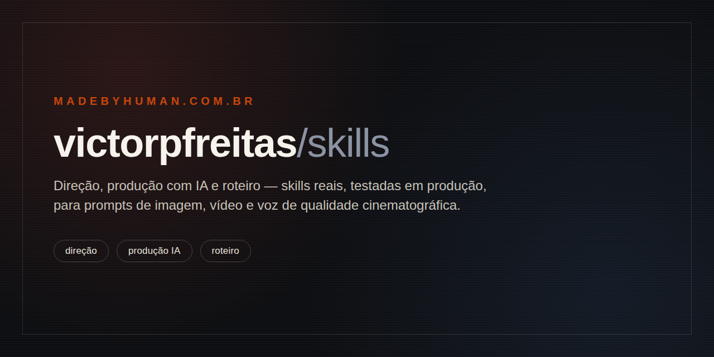

# skills

*Read this in [English](./README.en.md).*



Este repositório reúne as skills que uso no dia a dia de produção com IA generativa: pesquisa, vídeo, música e voz. Cada uma nasceu de um caso real, não de teoria, e só entrou aqui depois de testada em conversa real. São blocos de conhecimento prontos pra plugar na sua LLM de preferência e levar pra qualquer projeto que peça o mesmo nível de controle criativo que eu uso no meu.

## Sumário

- [A ideia](#a-ideia)
- [Skills](#skills)
- [Estrutura do repositório](#estrutura-do-repositório)
- [Como usar](#como-usar)
- [Como cada skill é feita](#como-cada-skill-é-feita)
- [Validar antes de contribuir](#validar-antes-de-contribuir)
- [Licença](#licença)

## A ideia

IA generativa não substitui direção. Ela precisa de alguém guiando o processo: decidindo o enquadramento, o tom do roteiro, a luz da cena, o timbre da voz. Sem direção, um modelo gera conteúdo genérico. Com direção, ele vira ferramenta de produção real.

Este repositório é esse método, aberto. Não são prompts soltos, é o raciocínio de roteirista, diretor de fotografia e produtor que uso todo dia, escrito como skills reutilizáveis. O que está aqui é o que eu de fato uso, não uma versão de vitrine.

Funciona com qualquer agente que suporte skills em Markdown (Claude Code, Codex e outros).

## Skills

| Skill | Categoria | O que faz |
| --- | --- | --- |
| [`pesquisa-de-conteudo`](./producao-ia/pesquisa-de-conteudo) | Produção IA | Valida se uma ideia de vídeo tem demanda e sugere um ângulo, antes de roteirizar. |
| [`seedance-prompter`](./producao-ia/seedance-prompter) | Produção IA | Transforma ideia, cena ou referência visual em prompts de vídeo prontos para o Seedance 2.0. |
| [`minimax-h3-prompter`](./producao-ia/minimax-h3-prompter) | Produção IA | Prompts no formato nativo do MiniMax H3 (T2VA/I2VA/FL2VA/L2VA/Ref2VA): vídeo com áudio gerado junto, diálogo com lip-sync, clone de voz e edição de vídeo existente. |
| [`elevenlabs-voiceover`](./producao-ia/elevenlabs-voiceover) | Produção IA | Formata roteiro em voice-over com tags emocionais do ElevenLabs Eleven v3, pronto para narração. |
| [`trilha-sonora-prompter`](./producao-ia/trilha-sonora-prompter) | Produção IA | Traduz o tom emocional de uma cena em prompt de trilha pronto pro Suno, com o vidIQ como alternativa direto na conversa. |
| [`thumbnail-titulo-otimizado`](./producao-ia/thumbnail-titulo-otimizado) | Produção IA | Gera e pontua thumbnail e título, fechando o loop gerar → pontuar → ajustar antes de publicar. |

## Estrutura do repositório

Cada categoria agrupa skills que atuam na mesma etapa da produção. Dentro de cada skill, `SKILL.md` é o ponto de entrada; `references/` só existe quando o assunto não cabe num único arquivo.

```
skills/
  .claude-plugin/marketplace.json      → manifesto do plugin marketplace
  producao-ia/
    pesquisa-de-conteudo/
      SKILL.md
    seedance-prompter/
      SKILL.md
      references/                      → estilo, câmera, ação, áudio, troubleshooting, mecânica do modelo, retake
    minimax-h3-prompter/
      SKILL.md
      references/                      → sintaxe oficial, modos base, modo Ref2VA, atribuição de referências, direção de áudio, edição de vídeo, troubleshooting, LoRA, skills oficiais da MiniMax
    elevenlabs-voiceover/
      SKILL.md
      references/                      → mecânica do modelo, troubleshooting
    trilha-sonora-prompter/
      SKILL.md
      references/                      → fórmula de style prompt, meta tags de estrutura e campo Exclude do Suno
    thumbnail-titulo-otimizado/
      SKILL.md
```

## Como usar

**No Claude Code**, o repo é também um plugin marketplace: instala uma vez e atualiza sozinho a cada mudança.

```
/plugin marketplace add victorpfreitas/skills
/plugin install victorpfreitas-skills@victorpfreitas
```

Depois de instalado, os skills disparam pelo contexto da conversa (ex.: "monta a decupagem dessa cena", "formata esse roteiro pro elevenlabs"), sem precisar chamar por nome.

**Em qualquer outro agente** (Codex, etc.), basta apontar para a pasta do skill desejado ou colar o conteúdo do `SKILL.md`. São arquivos Markdown puros, sem dependência de nenhuma plataforma.

## Como cada skill é feita

- Cada skill nasce de um caso real de produção, não de teoria solta sobre prompting.
- `references/` só existe quando o `SKILL.md` sozinho ficaria longo demais pra ler de uma vez.
- Todo trigger de skill é testado em conversa real antes de entrar no repo.
- Nada entra aqui sem passar por revisão de dado sensível (cliente, pessoal, interno).
- Um skill sai do repo quando para de refletir como eu realmente trabalho.

## Validar antes de contribuir

Antes de subir qualquer mudança, valide o marketplace e o frontmatter dos skills:

```
claude plugin validate .
```

Todo push e pull request também roda essa validação automaticamente via GitHub Actions (veja `.github/workflows/validate.yml`).

## Licença

MIT. Veja [LICENSE](./LICENSE).

---

Um método de [Victor Freitas](https://madebyhuman.com.br/victor) ([@victorpfreitas](https://x.com/victorpfreitas)), direção criativa com IA na **[Made by Human](https://madebyhuman.com.br/victor)**.
